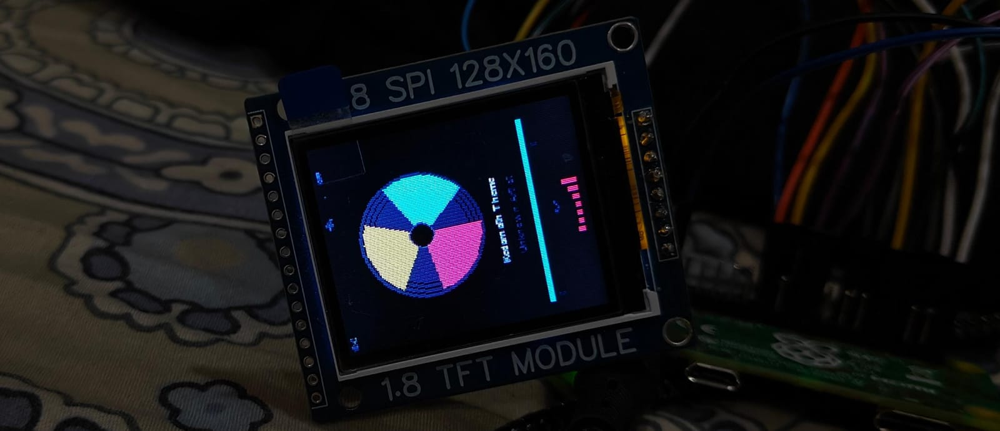
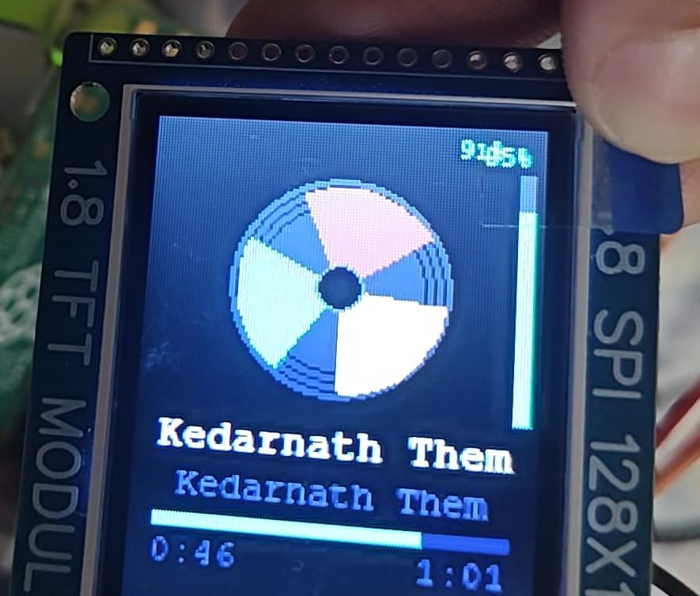
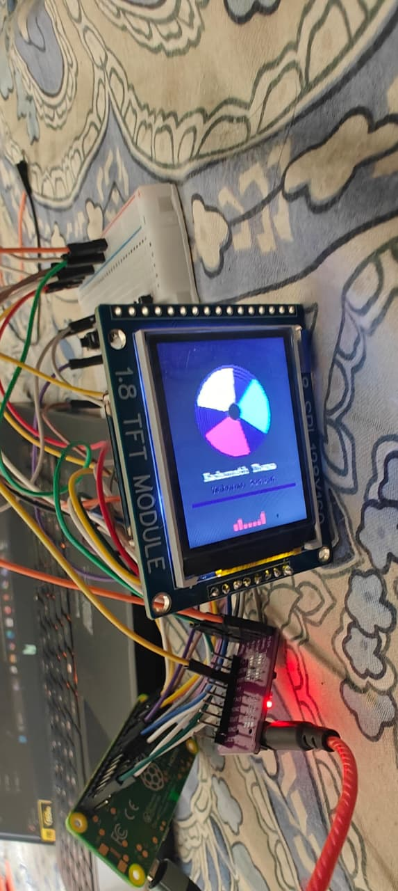
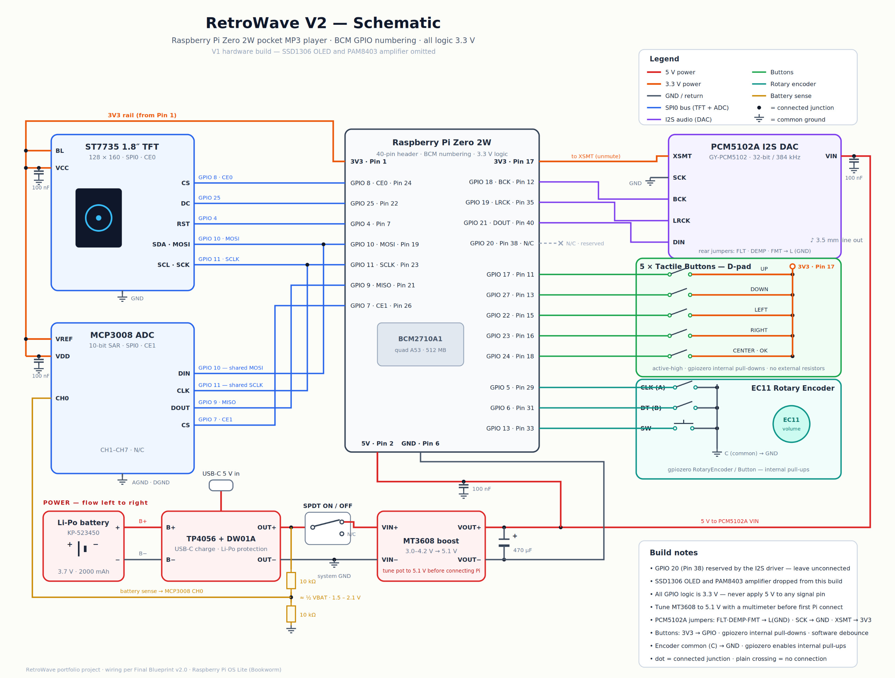

# RetroWave 🎵

A pocket MP3 player built on Raspberry Pi Zero 2W — retro iPod aesthetic, custom Python software stack, I2S DAC audio output, and a 1.8" TFT display with an animated rotating disc UI.

> **Status:** V1 fully functional. Pi Zero 2W burnt out during power circuit upgrade; unavailable across Indian retailers for 4+ months. Resuming on Pi 3B+ once sourced.

---

## Demo

| Display closeup | Full breadboard |
|---|---|
|  |  |

---

## Features

- Animated rotating colour disc synced to playback
- Real-time EQ visualiser bars
- ID3 tag reading — title, artist, duration from MP3 metadata
- Progress bar with elapsed / total time
- Shuffle, Repeat (off / one / all), EQ presets (FLAT / BASS / TREBLE / VOCAL / KARAOKE)
- Play / Pause, Next, Prev via 5-button D-pad
- EC11 rotary encoder for volume
- Battery percentage display via MCP3008 ADC
- systemd autoboot — starts on Pi power-up, no terminal needed
- GPIO abstraction in buttons.py — keyboard bindings for desktop testing, swap for RPi.GPIO on Pi

---

## Hardware

| Component | Part | Notes |
|---|---|---|
| SBC | Raspberry Pi Zero 2W | BCM2710A1, quad A53, 512 MB |
| Display | ST7735 1.8" TFT | 128x160, SPI0 CE0 |
| DAC | PCM5102A (GY-PCM5102) | 32-bit / 384 kHz, I2S, 3.5 mm line out |
| ADC | MCP3008 | 10-bit SAR, SPI0 CE1, battery sense on CH0 |
| Buttons | 5x tactile switches | D-pad layout, active-high, gpiozero pull-downs |
| Encoder | EC11 rotary encoder | Volume control, gpiozero internal pull-ups |
| Battery | Li-Po KP-523450 | 3.7 V, 2000 mAh |
| Charger | TP4056 + DW01A | USB-C, Li-Po protection |
| Boost | MT3608 | 3.0-4.2 V to 5.1 V for Pi |
| Power switch | SPDT | Hard on/off |

**Schematic (V2):**

---

## Software

\\\
main.py      — entry point; scans Music/, initialises Player, launches display
player.py    — playback engine (pygame.mixer) — play, pause, next, prev
display.py   — full UI loop at 30 FPS; rotating disc, progress bar, EQ bars
buttons.py   — input abstraction; keyboard now, GPIO pin map documented in comments
library.py   — MP3 scanner using mutagen; reads ID3 tags
settings.py  — shuffle / repeat / EQ preset state (in-memory)
\\\

**Dependencies:** pygame, mutagen, gpiozero (Pi only), RPi.GPIO (Pi only)

---

## Run on Desktop

\\\ash
pip install pygame mutagen
python main.py
\\\

Place .mp3 files in the Music/ folder first.

| Key | Action |
|---|---|
| SPACE | Play / Pause |
| Right arrow | Next track |
| Left arrow | Previous track |
| S | Toggle shuffle |
| R | Cycle repeat |
| E | Cycle EQ preset |

---

## Key Wiring Notes

- ST7735 RST to GPIO4 / Pin 7 (not GPIO27 — conflicts with Down button)
- MCP3008 on SPI0 CE1 / GPIO7 / Pin 26 (not SPI1 — conflicts with I2S)
- GPIO20 / Pin 38 left unconnected (reserved by I2S hifiberry-dac overlay)
- PCM5102A XSMT tied firmly to 3.3 V (floating = noisy audio)
- Buttons: 3.3 V leg + pull_up=False
- MT3608 tuned to 5.1 V before connecting Pi

---

## Roadmap

| Version | Goal | Status |
|---|---|---|
| V1 | Offline MP3 playback, full UI | Complete |
| V2 | KiCad PCB, refined UI | Planned |
| V3 | Bluetooth A2DP output | Planned |
| V4 | Wi-Fi streaming | Planned |

---

*Built by Hrishikesh Dhabade — EEE, MIT Manipal*
